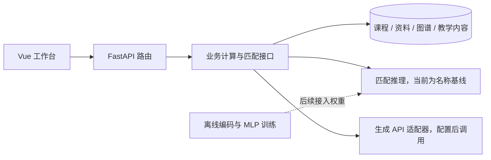

# 架构与维护边界

## 结构选择

单仓库、单后端服务。Vue 负责交互，FastAPI 提供业务 API，SQLAlchemy + SQLite 保存首版数据，Alembic 管理表结构。
图谱存为普通关系表，一跳邻域与关联查询先用 SQL 完成，不引入独立图数据库。
离线训练是独立 Python 包，后续通过 `services/matching.py` 中的 `Matcher` 协议接入推理。

前端按页面加载功能，API 请求统一在 `api.ts`。初期用 Vue 的 ref/computed 保持局部状态；出现跨页面编辑状态需求后再考虑 Pinia。
后端路由按课程、资料、图谱、问题、答疑、教学工具与覆盖划分。当前规模把 schema 放在对应路由中，避免为少量类型增加多层跳转。
资料解析使用 FastAPI BackgroundTasks 并保存任务状态；进程重启后将中断任务明确标为失败。尚未引入外部队列或自动重试。

## 已落地的数据

| 对象 | 用途 |
| --- | --- |
| Course | 课程名称与空间 |
| Material / Chunk | 有版本的资料、段落定位和原文 |
| KnowledgeNode / KnowledgeEdge | 节点、别名、候选或已确认关系、来源与关系版本 |
| NodeEvidence | 节点与资料片段的多对多关联 |
| TeachingContent | 答疑、题目、备课的共享草稿与当前审核版本 |
| ContentNode / ContentCitation | 教学内容关联知识点与来源 |

所有课程内对象都保存 `course_id`。现有读取接口限定当前课程；未来写入关联时，也必须在该课程内查询目标对象。
这是课程数据范围隔离，尚未实现用户身份和访问授权，不能当作已完成权限系统。
ID 使用可读演示 ID 或 UUID，不使用内容哈希。数据库配置和本地存储统一以 `work` 为根路径。

第一阶段已加入 IngestionJob、Question、QuestionPrediction、QuestionLink、ReviewRecord 和 ContentRevision。
后续随业务加入 CourseMember、QuestionBatch、QuestionGroup 和 ExperimentRun。
机器预测和人工确认分开保存，避免覆盖历史记录。备课正文已经按环节保存，每段保留节点、引用与所选题组。审核单位是整份教案，关联按环节聚合；不声称已实现逐段独立签核。

## 覆盖与审核规则

当前目标集合为课程全部 `confirmed` 节点。资料覆盖要求节点关联的资料仍有效。
题目/备课覆盖要求 `status=approved`、`reviewed_version=version` 且未归档；任一引用资料失效时，内容退出正式覆盖。
空目标集合返回 `ratio=null`，前端显示无可统计节点。统计结果由数据库计算，API 生成服务不参与计数。

当前答疑编辑接口已增加内容版本、修订快照与审核事件，正文、引用或关联变更会使旧审核失效；后续问题组也沿用此规则。
正式导出只接收当前有效审核版本。资料更新保留旧版本，受影响内容先进入重新核查状态。

## 生成与检索接入顺序

第一阶段已实现一个兼容 JSON 输出的 HTTP 生成适配器，使用后端环境变量管理密钥，不预建多供应商注册机制。
答疑、题目、备课共用证据查询和模型客户端，各业务单独定义结构化输入输出。
引用 ID 只能来自本次证据集合，图扩展只读取已确认关系并限制在一跳。
文件解析与外部输出保留必要结构校验；内部业务对象不重复检查。不要用空列表吞掉解析或 API 失败。

## 技术依据

- [Vue 官方工具链建议](https://vuejs.org/guide/scaling-up/tooling.html)：Vue + TypeScript + Vite。
- [FastAPI lifespan](https://fastapi.tiangolo.com/advanced/events/)：在应用生命周期内创建和释放数据库引擎。
- [SQLAlchemy 2.0 ORM](https://docs.sqlalchemy.org/en/20/orm/quickstart.html)：使用类型化映射和 Session。
