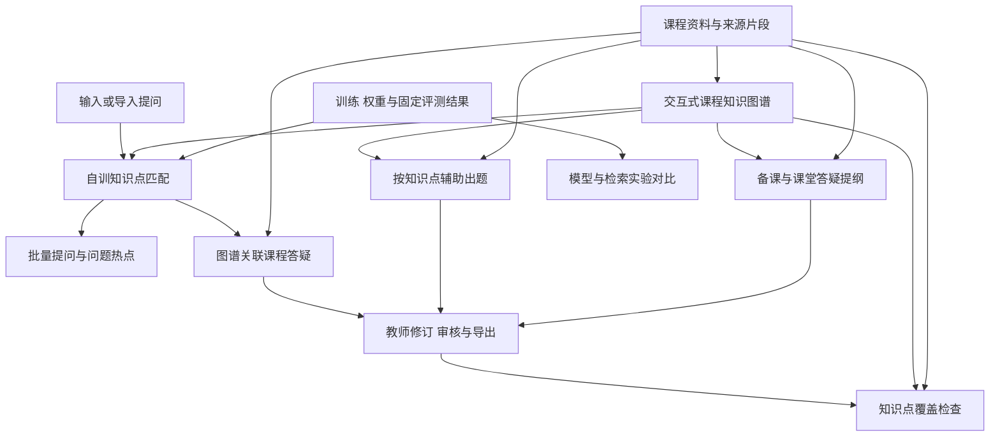
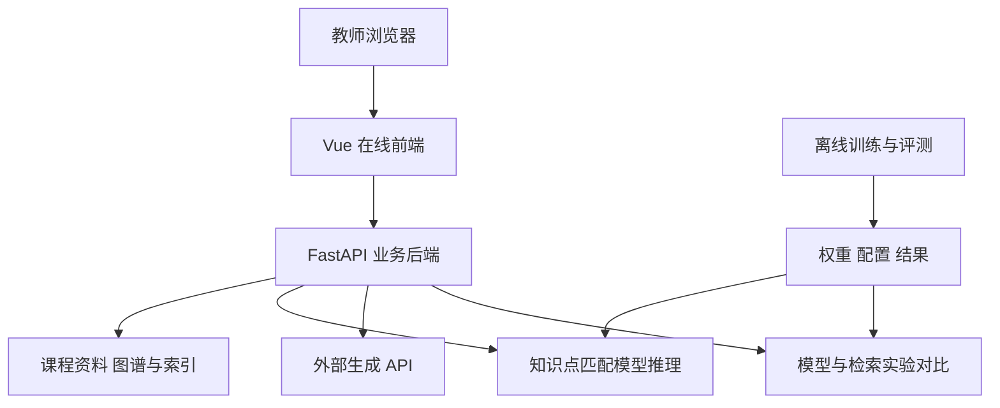

# 融合课程知识图谱与自训匹配模型的智能助教系统项目大纲

更新日期：2026-10-27。适用团队：4 人；开发周期：2–3 周，按约 10–15 个工作日安排。

本大纲说明系统定位、功能需求、技术架构、自主训练、实施安排与验收方式。项目当前处于方案设计阶段，数据规模和模型参数为初步规划，实际效果通过后续实验验证。

## 1 项目概述与选题目标

### 1.1 项目名称与定位

项目名称：**融合课程知识图谱与自训匹配模型的智能助教系统**。

系统面向教师和助教，接收课程资料与学生提问，构建有来源的课程知识图谱，通过自主训练的问题—知识点匹配模型将提问链接到图谱，再结合课程检索和外部大语言模型接口（API）完成答疑、出题与备课辅助。系统同时提供问题热点、知识点覆盖检查和实验对比展示。

知识图谱以知识点为节点、概念间关系为边，并关联原始资料、提问、题目和备课内容。初期使用自然语言处理课程资料，后续通过独立课程空间、资料索引和图谱配置扩展到其他课程。

### 1.2 功能范围

系统自主训练**问题—知识点匹配模型**，用于将教学提问关联到课程知识图谱。系统设置以下七项功能：

| 编号 | 功能名称 | 核心产出 |
|---|---|---|
| 1 | 交互式课程知识图谱 | 可搜索、点击和修订的知识点及关系，关联来源资料 |
| 2 | 图谱关联的课程答疑 | 关联知识点、引用证据、可审核的答疑草稿 |
| 3 | 批量提问与问题热点 | 问题批次、相似问题候选、知识点提问分布 |
| 4 | 按知识点辅助出题 | 题目、答案与解析、知识点标签、资料依据 |
| 5 | 备课与课堂答疑提纲 | 单次课或单个章节的讲解提纲、例子和待补充事项 |
| 6 | 模型与检索实验对比 | 基线与自训匹配模型推理结果、训练记录、固定评测结果 |
| 7 | 知识点覆盖检查 | 资料、已审核题目和备课内容的覆盖清单与缺口 |

所有功能共用课程、知识点、资料片段与审核记录，避免形成七套互不关联的业务。自动评分、查重、独立学生学习门户等不进入本期范围。

### 1.3 目标与验收方向

- 教学目标：帮助教师整理提问、准备有依据的答疑、出题与备课，能回看原文并修订结果。
- NLP 目标：完成真实的问题—知识点匹配训练，保留传统或固定相似度基线，评估实体关联和生成证据的质量。
- 系统目标：形成在线可访问的前后端系统，老师能够通过网页操作七项功能并看到自训模块的实际输出。
- 扩展目标：更换课程资料后可以复用系统流程，课程之间保持隔离；新课程的模型效果另行验证。

## 2 需求分析与产品边界

### 2.1 助教系统与助学系统的区别

| 维度 | 助学系统的典型形态 | 本项目 |
|---|---|---|
| 主要使用者 | 学生 | 教师、助教 |
| 工作对象 | 个人学习需求 | 一门课程的资料、提问和教学准备任务 |
| 核心业务 | 学习解释、练习与个性化建议 | 整理问题、准备答疑、出题、备课和检查覆盖 |
| 输出使用方式 | 学生直接使用 | 教师检查、修订与审核后使用 |
| 评价重点 | 学习帮助程度 | 整理质量、关联准确性、证据支持与业务可用性 |

学生是问题来源和正式反馈接收者。辅助出题与备课功能服务于教师的教学准备，并由教师审核生成内容。

### 2.2 角色与主要诉求

教师需要了解本章有哪些知识点、学生主要在问什么、答疑是否有依据，以及题目和备课是否遗漏目标内容。助教需要批量整理提问、定位资料和起草教学内容，并把不确定事项留给教师确认。

首版教师与助教可以共用教学人员角色，通过课程成员关系限制访问。先完成小范围课程协作，不开发复杂组织管理。

### 2.3 主要使用场景

教师上传 NLP 课程资料，系统形成候选知识图谱并显示来源。教师确认若干概念与关系后，导入一批课堂提问。自训匹配模型为每条问题推荐关联知识点，网页同步高亮，并展示问题原文与待确认状态。教师查看热点，打开一组问题，得到有引用的答疑草稿；随后选中相关节点生成题目和备课提纲，审核保存后查看知识点覆盖缺口。

资料中不存在的考试时间等课程规则不能凭通用知识补写。相关内容缺失时进入人工补充流程。

## 3 总体方案与功能联动

### 3.1 业务流程

> 课程资料入库 → 构建并确认知识图谱 → 导入或输入提问 → 自训匹配模型关联知识点 → 检索资料并生成答疑 → 按节点出题与备课 → 教师审核 → 覆盖检查与导出。

实验对比功能提供独立视图，能够复现基础匹配与自训匹配模型的同输入推理，并展示实际训练和评测产物。



### 3.2 外部 API 与自主工作的分工

| 部分 | 具体工作 | 主要证据 |
|---|---|---|
| 外部生成 API | 实体关系候选抽取、基于资料的答复、题目和备课草稿 | 输入输出约束、来源追踪、质量核查和失败处理 |
| 自训匹配模块 | 对问题与候选知识点进行相关性预测和排序 | 数据、训练代码、权重、日志、基线与保留测试 |
| 自主计算 | 实体归并、候选召回、图邻域查询、检索融合、相似问题整理与覆盖计数 | 算法与业务代码、计算定义、可检查结果 |
| 业务系统 | 图谱交互、共享上下文、审核与导出、课程隔离、在线部署 | 完整操作流程、在线访问与数据持久化验证 |

无需从头训练生成式大模型，也不把下载预训练编码器、调用生成接口或修改提示词称为自主训练。自训模型必须参与日常提问与图谱关联流程。

## 4 七项功能详细设计

### 4.1 交互式课程知识图谱

输入为课程资料和人工补充信息。首版围绕少量章节构建约 30–60 个经核查知识点，保留概念、算法、模型和评测方法等节点类型。

关系可先限定为包含、使用、适用任务和对比；先修关系须单独确认后才能用于讲解顺序建议。目录前后顺序不能直接作为先修依据。

功能包括节点搜索、点击查看、邻域展开、修改别名、关系候选确认及来源跳转。每条关系保存来源、版本和候选或已确认状态。API 提出候选，程序检查结构与重复，教师核对事实。

最小交付：一个可交互子图，节点与关系可查来源，点击节点能查看关联资料、问题、题目和备课内容。复杂全图自动排版、无限层级推理和大规模图数据库优化留作后续。

### 4.2 图谱关联的课程答疑

输入教学问题后，先召回候选知识点，再由自训匹配模型进行排序与关联。系统高亮建议节点，在当前课程内检索资料，按需加入已确认图邻域的关联证据，再调用同一生成 API 起草答复。

输出包括答疑正文、关联节点、引用片段和待确认事项。教师可以改选节点、修改正文和补充依据，审核后保存或导出。节点匹配失败时仍可使用常规资料检索，不把一次匹配失败等同于资料无法回答。

首版使用直接检索加有限一跳图谱补充，严格控制证据长度；先不引入复杂多代理规划。答复中节点与引用可点击回到图谱及原文。

最小交付：单问题答疑、批次中选定问题组的统一答疑、引用预览、人工审核和导出。图谱扩展可能引入噪声，需与不使用图谱的检索进行对比。

### 4.3 批量提问与问题热点

教师粘贴或导入一批纯文本问题，系统为每条问题保留稳定编号与原文，调用自训匹配模型产生知识点关联建议，再用固定句向量或 TF-IDF 相似度提出重复问题候选。

知识点相同并不代表问题诉求相同。相似分组由教师确认，可合并或移出成员，未归组问题单独保留。教师可对问题或问题组直接发起课程答疑。

热点按问题与知识点的关联记录计算。默认统计已确认关联，预测关联可以单独预览并明确标为待确认。每个节点按不同问题 ID 去重计数；一个问题可以计入多个节点，因此节点计数之和不代表独立问题总数。

最小交付：单批次问题列表、节点关联修订、相似候选组、热点排序与图谱高亮。热点仅代表本批次提问分布，不推断全班掌握程度。

### 4.4 按知识点辅助出题

教师在图谱选择少量目标节点，填写题型、数量和难度要求。后端取得目标知识点及证据，调用生成 API 返回题干、答案、解析、建议知识点与来源。

首版支持单选题和简答题，每次最多生成约 5 题，目标知识点控制在约 1–5 个。程序检查输出结构、选项与答案一致性、必要字段、知识点范围和近重复题；题意、答案正确性、实际难度与关联是否准确由教师审核。

生成结果是候选题，难度标签是设定与建议，尚不代表经过测量的难度。对涉及多个知识点的题目，教师确认最终关联后才计入正式题目覆盖。

最小交付：节点选择、参数输入、题目生成、编辑审核、保存到课程题库与 Markdown/HTML 导出。未经审核的草稿保留状态，不自动发布为正式试卷。

### 4.5 备课与课堂答疑提纲

教师选择章节或知识点，填写教学目标、课堂时长和重点问题。后端复用证据检索、图谱上下文与生成接口，输出一节课或一个章节的备课草稿。

内容包括讲解目标、重点概念、分段安排、资料依据、例子建议、关联题目与待补充事项。若使用先修关系，只引用已确认关系；缺少关系时根据教师指定顺序组织，并注明待调整。

系统检查分段时长之和是否与输入时长一致，检查所列知识点和引用是否存在。例子和讲解的教学适用性由教师判断，不因形式完整就宣称能提升教学质量。

最小交付：一份可编辑的课时提纲、节点与资料链接、从已审核题库选择例题、审核保存及导出。首版不生成完整课件或一学期教学日历。

### 4.6 模型与检索实验对比

实验页展示自训匹配模型的训练配置、数据版本、训练及验证曲线、模型权重版本和固定保留测试结果；对一个新问题，可切换基础匹配与自训匹配，查看相同候选节点的排序与关联结果。

还可对比普通检索与图谱补充检索，展示各自证据与生成草稿。后者实验固定生成模型、参数和证据预算，说明生成结果存在波动，不能以单次演示替代整体评价。

最小交付：真实训练记录、基线对照表、错误案例和同输入模型推理。训练离线完成，网页不承担长时间在线重训；预计算结果标明实验版本，不伪装成实时训练。

### 4.7 知识点覆盖检查

教师选择课程、章节或目标节点集，查看每个知识点是否已有可用资料、已审核题目与已审核备课内容。所有统计使用同一明确的目标集合，默认排除草稿、失效引用与归档对象。

设范围内已确认知识点集合为 U，提供三项独立指标：

```text
资料覆盖率 = U 中至少关联一个有效资料片段的节点数 / |U|
题目覆盖率 = U 中至少关联一道已审核题目的节点数 / |U|
备课覆盖率 = U 中至少关联一个已审核备课段落的节点数 / |U|
```

U 为空时显示未选择范围或暂无可统计节点，不计算百分比。界面同时显示分子、分母与缺口清单。

点击缺口可定位图谱节点，进一步补充资料，或跳转按知识点辅助出题出题、备课与课堂答疑提纲备课；完成审核后刷新覆盖。覆盖率由数据库关系确定性计算，API 可以解释清单，但不能编造数值。

这些指标表示已建立的内容关联，不能直接代表知识讲解充分、题目有效或学生已经掌握。自动建议的题目标签与备课关联须经教师核查，才进入正式覆盖统计。

## 5 问题与知识点匹配模型训练方案

### 5.1 任务定义

给定问题 q 与候选知识点 c，模型预测二者相关性，并对候选节点排序。一个问题允许关联多个知识点；没有合适节点或分数不足时进入人工确认，不能强制匹配。

知识点输入文本由已确认的名称、别名和简短解释构成，固定课程与版本。首版任务是已知课程图谱内的新问题匹配，不直接宣称能泛化到任意新知识点或其他学科。

### 5.2 候选召回与推理

先用名称和别名、BM25 或固定句向量形成约 10–20 个候选，记录召回方法与固定预算。随后由自训匹配模型对相同候选评分，按验证集确定的阈值与数量上限展示约 1–3 个关联建议。

候选集没有正确节点时，后续排序无法找回该节点，因此召回与排序必须分别评估。教师可搜索候选之外的节点并纠正关联；人工结果与机器预测分别保存。

### 5.3 模型结构与训练

首版确定采用**冻结预训练句编码器，加自主实现的小型多层感知机（MLP）匹配头**。训练可在本地或可用云端算力完成，部署时加载固定编码器与保存的匹配权重。

```text
问题文本 q → 冻结编码器 → 向量 u
知识点文本 c → 同一编码器 → 向量 v
配对特征：|u-v|、u 与 v 的逐维乘积、余弦相似度及少量词面特征
匹配头：小型全连接层、激活与正则化、输出相关性分数
训练目标：问题—节点标注对的二分类损失
```

使用 PyTorch 编写匹配头、数据加载、训练、验证、保存与推理流程。优化器和自动求导可使用框架实现，编码器可复用成熟组件。

训练的是任务匹配头，不把它称为从零训练语言模型或完整编码器微调。模型输出分数未经校准时不能当作“答案正确概率”。

初期控制隐藏层规模，使用验证集选择训练轮次、阈值和正则化；不预设一定优于固定相似度。样本较少时保留更简单的相关性模型作诊断，但不另起问题类型分类或独立证据重排训练路线。

### 5.4 数据与标签

计划先选择少量主题，整理约 150–250 条原始问题，每条配若干候选节点，形成约 750–1500 个正负样本对。规模是开发预算，不能当作已获取数据或效果保证。

- 正例：教师或标注者确认问题确实涉及该知识点。
- 困难负例：词语相近、同一章节、不同诉求或相邻概念，但不应直接关联的节点。
- 无可用节点样例：问题超出当前图谱，单独标注，用于检查误关联。
- 标注来源：优先脱敏真实问题，不足部分人工编写；API 可辅助提出样例与候选，但不能代替人工金标准。

全员参与标注，先共同试标确定规则，对部分样本双人独立核对并记录分歧。可以多标签，不能为了制造负例把另一合理关联节点误标为不相关。

### 5.5 数据划分与防泄漏

按原始问题家族约 70%/15%/15% 划分训练、验证与测试，再分别生成或整理样本对。同一问题、改写及其全部正负对必须留在同一集合。

正式划分先于训练与特征拟合。词面可学习统计和配对特征的归一化参数只在训练集拟合；验证集选择超参数、checkpoint 与关联阈值，测试集不参与选参。

已知图谱的节点描述可用于候选索引，这是任务设定；测试问题的金标准关联和人工答案不能进入模型输入或调参。用于比较的图谱、编码器、候选召回和资料版本应固定。

若后续声称能匹配从未见过的知识点，再做知识点或主题留出实验；若声称跨课程有效，再设第二课程测试。本期主要结论限定在已知课程图谱的新问题匹配。

## 6 知识图谱、检索与生成技术

### 6.1 课程资料处理

支持课程 DOCX 文档的文字与表格，另支持文本型 PDF、TXT/Markdown。保留章节、段落、资料版本和片段 ID；PDF 可保留页码，DOCX 使用章节与段落定位。

《NLP知识体系(1).docx》作为首批知识库与演示语料，训练所需问题和知识点关联标签另行标注。图片、扫描内容和嵌入公式不纳入首版可靠自动理解范围，需提示未提取内容。

资料按自然边界切块，保留必要上下文。解析失败应可见，不能静默建立空索引。

### 6.2 图谱构建与计算

目录提供包含层级，API 根据限定类型抽取概念和关系候选。后端完成结构校验、实体规范化、别名归并、重复边处理及来源保存，教师确认重要关系。

每条关系需要可核查证据，缺乏证据的提议保持待审。先修子图检查自环和有向环后才用于顺序建议，其他关系允许合法成环。

首版使用节点、关系及关联表保存图谱，图查询控制在邻域和简单关联范围。前端使用交互图库显示节点与事件；不因界面出现关系图就宣称实现完整 GraphRAG 系统。

### 6.3 证据组织与生成

普通检索与图谱补充检索共享课程范围。后者根据自训匹配模型的节点建议查询已确认邻域，补充关联片段，与普通检索结果去重、排序并限制证据预算。

课程答疑、辅助出题与备课共用证据构建服务与模型适配层，各自使用明确的输入输出结构。首版只固定一种生成 API 服务，模型与参数通过开发样例确定。

后端校验引用 ID 属于本次检索结果，提供原文预览；有效引用存在不等于支持结论，仍需教师检查。结构化输出解决解析问题，不能代替事实核查。

资料抽取与长任务保存处理状态，使用缓存和有限重试。节点已保存的信息直接查询数据库，避免每次点击图谱都重新请求模型。

## 7 架构、数据与在线部署

### 7.1 系统架构



本地训练不限制线上访问。训练完成后，将编码器依赖、自训权重与后端部署到服务器；前端通过后端调用模型和外部服务。密钥保存在后端配置，浏览器不直接持有供应商密钥。

建议前端 Vue 3，后端 FastAPI，训练 PyTorch；关系数据库与持久化文件保存业务、图谱、索引和模型。小范围演示可先用 SQLite 并控制写入并发，实际多人部署再按需要选择 PostgreSQL。无需一开始引入专用图数据库、微服务与独立 GPU 推理集群。

### 7.2 主要数据对象

课程与成员、资料与片段、知识节点与别名、知识关系与来源、问题批次、原始问题、候选问题组、机器预测与人工关联、答疑、题目、备课段落、引用、审核记录、训练与评测版本。

所有业务对象具有 course_id，稳定节点和片段 ID 用于跨页面联动。问题建议、教师确认、模型版本与资料版本分别保留，不用新结果覆盖历史证据。

### 7.3 审核与版本规则

生成对象具有草稿、待审核、已审核等状态；正式导出只使用已审核内容。修改正文、引用、知识点关联或问题组成员后，相关旧审核失效。

覆盖检查只统计当前有效版本；引用资料更新或失效时，受影响内容需重新检查，覆盖结果刷新。保留旧资料版本供历史追溯，已有导出物属于历史快照。

涉及已有审核内容的节点归并或删除采取受限操作，先显示影响范围，再由教师确认并重新核查关联内容。首版不做复杂自动版本迁移。

### 7.4 在线演示目标

前端、后端、资料存储、索引和自训匹配模型一起部署，提供 HTTPS 链接与教师测试账号。仅上传静态页面不能证明模型与后端已上线。

第 2 天以前用一个真实生成请求和一个自有预测接口验证访问链路。资源、网络、依赖与编码器下载条件在首日核实，不预设已有永久免费服务器。

最终从另一台设备或校外网络验证登录、上传、图谱交互、模型推理、生成、审核与保存；确认重启后已保存的数据和模型仍可用。录屏可作演示备用，不替代真实在线验收。

## 8 评测与成果证据

### 8.1 知识点匹配基线与指标

比较名称/别名匹配、固定句向量相似度与自训匹配头。各排序方法使用相同候选集、编码器与数据版本，阈值各自在验证集选择。

- 候选召回：报告正确节点进入候选前 k 项的情况，区分召回失败与排序失败。
- 节点关联：报告多标签精确率、召回率与 F1 分数（精确率与召回率的调和平均）的明确统计方式，以及首个正确节点的排名指标；以问题为单位分析，避免大量负样本导致虚高准确率。
- 无合适节点样例：单列误关联比例，不通过强制 Top-1 把所有问题挂到某个节点。
- 失败分析：同义表达、近邻概念、否定、超出图谱和资料解释不足等。

主报告保留少量一致指标并给出分母、样本量和示例，不堆叠多种指标替代分析。训练若不如基线，报告真实结果和原因；业务默认策略依据验证集选择，不能编造增强效果。

### 8.2 图谱与生成对比

固定生成模型、参数、问题、资料和证据预算，对比普通检索与图谱补充检索，人工检查证据相关性、回答支持性和关键条件遗漏。对一部分样例双人核查。

生成存在波动，单次截图不构成整体质量结论。若没有完成新知识点或跨课程留出测试，不做相应泛化声明。

### 8.3 七项功能验收

| 编号 | 功能 | 最小验收任务 |
|---|---|---|
| 1 | 交互式课程知识图谱 | 从资料得到候选图谱，确认关系，点击节点查看来源和关联对象 |
| 2 | 图谱关联的课程答疑 | 对新问题真实调用自训匹配模型和生成 API，节点高亮、引用可查，审核后导出 |
| 3 | 批量提问与问题热点 | 导入一批提问，修订关联与分组，热点计数能追溯到不同问题 ID |
| 4 | 按知识点辅助出题 | 选节点生成单选或简答题，检查编辑、审核、保存及节点关联 |
| 5 | 备课与课堂答疑提纲 | 选章节生成单次课提纲，时长总和可检查，来源和题库例题可关联 |
| 6 | 模型与检索实验对比 | 展示真实训练记录与固定测试结果，同一问题可切换基线与自训模型进行推理 |
| 7 | 知识点覆盖检查 | 显示范围、分子分母与缺口，审核新题或备课后刷新相应覆盖 |

同时验证课程隔离、无证据、空目标集合、模型或生成接口失败、引用失效和审核失效。覆盖率不代表教学效果，系统流程通过也不代表真实教师已经认可。

## 9 四人分工与实施安排

### 9.1 分工

| 成员 | 主责 | 主要交付 |
|---|---|---|
| A | 前端与图谱联动 | 统一工作台、图谱交互、问题高亮、实验与覆盖检查展示、审核界面 |
| B | 后端 资料与部署 | 解析、图谱与关联数据、权限、审核状态、覆盖计算、在线部署 |
| C | 匹配模型与问题分析 | 标注规范、候选召回、自训模型、实验结果、问题关联与分组 |
| D | API 与教学工具 | 图谱候选抽取、证据组织、课程答疑、共用生成服务、出题与备课模板及核查 |

全员参与提问标注、关系核查和生成内容评审。A 与 B 首日确定节点与片段结构，C 与 D 对齐节点匹配和证据检索，B 与 D 共享审核与生成对象接口。

### 9.2 约 10–15 个工作日安排

| 时间 | 重点 | 阶段产物 |
|---|---|---|
| 第 1–2 工作日 | 确定共享接口与节点类型，验证附件解析、API 与在线访问，试标数据 | 可访问骨架、资料样例、标注规范 |
| 第 3–4 工作日 | 图谱候选与确认、基础检索答疑、问题导入；冻结正式训练划分 | 图谱与答疑简化流程、数据划分与基线 |
| 第 5–6 工作日 | 匹配模型首次训练与接入，问题热点与关联修订；出题与备课复用生成框架 | 模型权重、真实节点联动、两种教学草稿 |
| 第 7–8 工作日 | 接通七项功能最小操作，补齐实验结果与覆盖检查，完成审核链路 | 七项功能可演示版本，验证集结果 |
| 第 9–10 工作日 | 冻结配置，运行保留测试，修复流程问题，验收部署与保存 | 两周核心版本、测试与错误记录 |
| 第 11–15 工作日（若有） | 修复、第二课程接入验证、完善题目与备课质量、报告和演示 | 三周完善版本 |

正式模型训练和特征拟合前完成数据家族划分。早期试跑用独立玩具数据；若使用正式候选问题，则对应家族只能进入训练集。

通过限定各功能的实现深度控制工期：图谱先做少量主题；出题只做两种题型和小批量；备课只做单次课提纲；实验展示复用离线结果；覆盖检查先做确定性关联统计。进度紧张时缩减主题、批量与排版复杂度，保障七项基本流程按期交付。

## 10 技术难点与项目亮点

### 10.1 主要难点

| 难点 | 应对方式 |
|---|---|
| 知识点别名与实体歧义 | 规范名称、别名归并、疑似冲突人工确认 |
| API 抽取关系不可靠 | 限定关系类型、记录来源、区分候选与已确认 |
| 匹配训练数据少或标注模糊 | 统一多标签规则、困难负例、控制模型规模、基线对照 |
| 召回遗漏正确节点 | 召回与排序分别评测，允许人工改选和常规检索回退 |
| 图谱检索引入噪声 | 限定已确认邻域、证据预算、保留普通检索对照 |
| 生成题目或提纲表面完整 | 格式与关联程序校验，教师审核事实与教学适用性 |
| 内容变更导致覆盖失真 | 审核失效规则、有效版本筛选、覆盖实时重算 |
| 在线服务与模型环境差异 | 早期部署验证、固定依赖与权重版本、持久化和异常处理 |

### 10.2 可成立的亮点

1. **训练模型直接服务图谱联动**：自训匹配模型输出进入提问高亮、问题分析与证据组织，能够展示具体作用。
2. **图谱连接多种教学任务**：同一批知识点和来源贯通答疑、出题、备课与覆盖检查。
3. **API 与自有计算协同**：外部模型处理复杂生成，自有模块完成匹配、图计算、统计和可核查流程。
4. **教学准备可以形成反馈回路**：覆盖缺口可以跳转补题或补备课，审核后回到覆盖面板检查变化。
5. **真实训练与可控实验可在线展示**：同时交付可访问系统和训练、基线、失败案例证据。

这些属于应用设计、独立训练与工程整合亮点。没有新方法和充分实验时，不宣称原创算法、准确率提升或教学效果已被证明。

## 11 交付物与演示建议

### 11.1 正式交付物

- 可访问的系统链接、教师测试账号、七项功能操作说明。
- 前后端源码、依赖与配置说明、示例课程与部署步骤。
- 自训匹配模型数据来源与标注指南、家族划分、训练脚本、配置、权重和日志。
- 基线与自训结果、图谱检索对比、人工核查记录与失败案例。
- 课程图谱、证据关联、已审核题目和备课样例、覆盖检查结果。
- 开题或结题报告、演示材料与必要备用录屏。

### 11.2 连贯演示流程

1. 打开系统并选择课程，查看资料解析与图谱来源。
2. 点击一个知识点，查看相邻节点和关联资料。
3. 导入问题批次，展示自训匹配模型节点预测、人工确认、热点与相似分组。
4. 打开一个问题发起答疑，查看高亮节点与引用，审核结果。
5. 选定知识点生成并审核几道题，再生成一节课的备课提纲。
6. 打开知识点覆盖检查页面，检查题目和备课覆盖，点击缺口返回对应功能补充。
7. 打开模型与检索实验对比页面，对比同一问题的基础匹配与自训匹配模型，展示训练日志及真实测试结果。

## 12 开题报告大纲与简介

建议汇报顺序：教学痛点 → 助教定位 → 七项功能与共享流程 → 图谱构建与联动 → 自训匹配模型任务与训练 → 检索和生成协同 → 数据与评测 → 在线部署 → 四人分工与计划 → 预期成果和局限。

可用于开题的项目简介：

> 本项目拟设计并实现一个面向教师与助教的课程智能助教系统，以自然语言处理课程资料为首个应用语料。系统构建有来源的课程知识图谱，自主训练问题—知识点匹配模型，将学生提问关联到图谱节点，并结合资料检索与外部生成 API 完成课程答疑、按知识点出题和备课提纲辅助。在此基础上，系统提供批量问题热点、知识点覆盖检查与模型实验对比，形成资料、问题和教学准备内容之间的联动。项目将通过固定基线、保留测试、人工证据核查和在线流程验收，评估自训模块与系统的实际效果。

## 13 资料与技术参考

- 《NLP知识体系(1).docx》：首批课程资料与图谱来源之一。
- [FastAPI 容器部署](https://fastapi.tiangolo.com/deployment/docker/)：后端与模型依赖的部署参考。
- [模型服务结构化输出](https://help.aliyun.com/en/model-studio/qwen-structured-output)：实体关系候选及教学草稿的结构化接口参考，具体支持按所选模型确认。
- [Cytoscape.js 官方文档](https://js.cytoscape.org/)：图谱显示、节点事件与交互参考。

参考文档用于实现设计，不能替代项目自身的模型评测、教学内容核查和在线访问证据。
